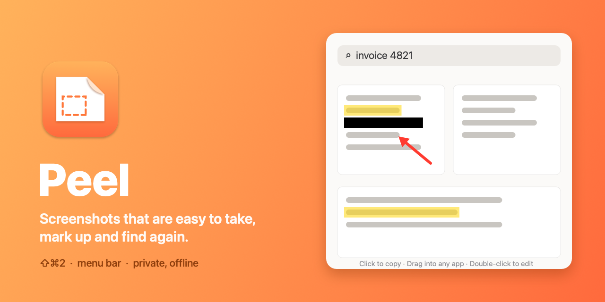

# Peel



A small screenshot app for the macOS menu bar.

Press **⇧⌘2**, drag over part of the screen, and the capture is copied and waiting on the **shelf**. From there you can drag it into any app, mark it up, pin it on screen, copy its text, or find it again later by searching for any word that was in it.

macOS 13+, Apple silicon. Everything stays on your Mac; nothing is uploaded.

What's new in each version: [CHANGELOG.md](CHANGELOG.md).

## Just want the app?

**[Download Peel.dmg](https://github.com/foxfoxesfox/Peel/raw/main/dist/Peel.dmg)** (or clone this repo and open `dist/Peel.dmg`), double-click it, and drag Peel into Applications. The first launch needs one extra step; see [Share with a friend](#share-with-a-friend).

## Use

| | |
|---|---|
| **⇧⌘2** | Capture an area. Press **Space** to pick a window instead, **Esc** to cancel. |
| **⇧⌘1** | Open the shelf and search. |
| Menu bar icon | Capture Area, Window or Full Screen; Show Shelf; Settings. |

The first launch opens a short welcome tour: what Peel does, the Screen Recording permission, your shortcuts, how to use the shelf, and a few settings (Launch at Login among them). After that Peel never opens a window on its own; it just sits in the menu bar. Change anything later in **How to Use & Settings…** (menu bar icon, or ⌘, while the menu is open). Both shortcuts can be changed there (they need ⌘ or ⌃; macOS ignores global shortcuts that use only ⌥ or ⇧⌥).

After a capture, Peel copies it to the clipboard and shows the shelf for a few seconds (both can be turned off). On the shelf:

- **Click** a capture to copy it again. **Drag** it into any app or folder.
- **Double-click** (or the pencil) to **edit**: Arrow (A), Box (R), Highlight (H), Text (T), Redact (B), Crop (C), with six colours, Undo (⌘Z or Delete). **Done** (Return) adds an edited copy to the shelf and copies it; the original stays.
- Hover for buttons: **Copy**, **Copy Text** (the words Peel read in it), **Pin** (floats above every window; Esc closes it), **Edit**, **Save** (a PNG or JPG copy in your save folder, `~/Pictures/Peel` by default), **Move to Trash**. Right-click shows the same actions.
- **Search** finds captures by the text in them. Every word you type has to appear, in any order.

Captures stay on the shelf for a month by default (1 day to forever, in Settings). Older ones go to the Trash, not straight to deletion, and saved copies are never touched. They live in `~/Library/Application Support/Peel/Captures` (**Show in Finder** in Settings).

**Redact** draws solid black into the exported pixels, so the hidden text is gone from the edited copy, not just covered. The original capture still has it: trash the original if it shouldn't be kept.

Taking the picture is done by macOS's own `screencapture` tool, so the selection, window highlight, Space and Esc behave exactly like ⇧⌘4. Text is read with Apple's on-device Vision framework.

## Updates

Peel updates itself. Once a day it checks this repository for a newer version (turn this off in Settings). When one is out, an **Update to Peel x.y…** item appears in the menu bar. **Install and Relaunch** downloads it, checks it (checksum, app identity, version, and that it's signed by the same developer certificate as the Peel you have), swaps it in and reopens Peel, keeping your settings, captures and Screen Recording permission. **Check for Updates…** in the menu checks right away. The check is a plain download from GitHub; nothing about you or your captures is sent.

## Share with a friend

```bash
./make-dmg.sh            # -> dist/Peel.dmg
```

Send `dist/Peel.dmg` (AirDrop, Drive, a message), or point them at this repo. Your friend then:

1. Double-clicks the DMG. A window opens; they drag **Peel** onto **Applications**.
2. Opens Peel from Applications. The first time, macOS blocks it because it isn't notarized by Apple ("Apple could not verify…"). They click **Done**, then go to **System Settings → Privacy & Security**, scroll down, click **Open Anyway** next to Peel, and confirm. They only do this once.
   (On macOS 14 and older, right-click Peel → **Open** → **Open** works too.)
3. The welcome tour asks for **Screen Recording**: **Allow…** opens System Settings, they turn on Peel, then click **Quit & Reopen** in the tour. Also once: updates keep the permission.

Your friend doesn't need a certificate or anything else. Skipping the warning in step 2 entirely needs an Apple Developer ID ($99/year) to sign and notarize the app.

`make-dmg.sh` asks macOS for permission to control Finder the first time (to lay out the window). If you decline, the DMG still works, just without the arrow background.

## Build

```bash
./build.sh               # -> build.noindex/Peel.app
build.noindex/Peel.app/Contents/MacOS/Peel --selftest   # text recognition, search, redaction, crop, saving, update checks
```

Install your own build:

```bash
killall Peel 2>/dev/null; sleep 1; rm -rf /Applications/Peel.app
ditto --norsrc --noextattr build.noindex/Peel.app /Applications/Peel.app && open /Applications/Peel.app
```

Use the copy in Applications: macOS ties the Screen Recording permission to one copy of the app, so copies run from other folders make it ask again. `ditto --noextattr` leaves out the Finder tag iCloud puts on files in a synced Desktop folder, which would otherwise fail a strict signature check.

## Signing (for the maintainer)

macOS remembers the Screen Recording permission by the app's signature, on your Mac and on everyone else's. An ad-hoc signature (what `build.sh` falls back to) changes with every build, so every update would ask everyone for the permission again. A free self-signed certificate keeps it the same, and the updater only accepts new versions signed with it.

1. Open **Keychain Access** › menu **Keychain Access** › **Certificate Assistant** › **Create a Certificate…**
2. Name: **Peel App Signing**. Identity Type: **Self Signed Root**. Certificate Type: **Code Signing**. Tick **Let me override defaults**, set the validity to **3650** days, and keep the keychain as **login**.
3. Run `./build.sh`. It prints `signed with "Peel App Signing"`. The first time, macOS asks whether codesign may use the key: click **Always Allow**.

To use another name, run `PEEL_SIGN_ID="My Cert" ./build.sh`.

**Back it up and keep it private.** If the certificate is lost, a new one makes every installed Peel refuse the next update (by design) and ask for Screen Recording again. Export it from Keychain Access (right-click the certificate › **Export…** › `.p12`, with a password) to somewhere safe outside this repo, such as a password manager. Never commit it: `.gitignore` blocks `.p12`, `.cer`, keys and keychains.

## Publishing an update (for the maintainer)

1. Make your changes and bump the version in `build.sh` (`CFBundleShortVersionString`, e.g. 1.1, and `CFBundleVersion`, e.g. 2).
2. Add a `## [1.1] - <date>` section at the top of `CHANGELOG.md`. Its text becomes the "What's new" in the update window.
3. Run `./make-dmg.sh`. It builds `dist/Peel.dmg` and `dist/latest.json` (version, download link, checksum, notes).
4. Commit and push both files. Within a day, everyone's Peel offers the update.

If the version number doesn't go up, nobody is offered anything. Always push the DMG and `latest.json` together. The repo's social preview image is `Resources/social-preview.png` (regenerate with `swift scripts/poster.swift Resources/social-preview.png`); upload it once in GitHub › Settings › General › Social preview.
